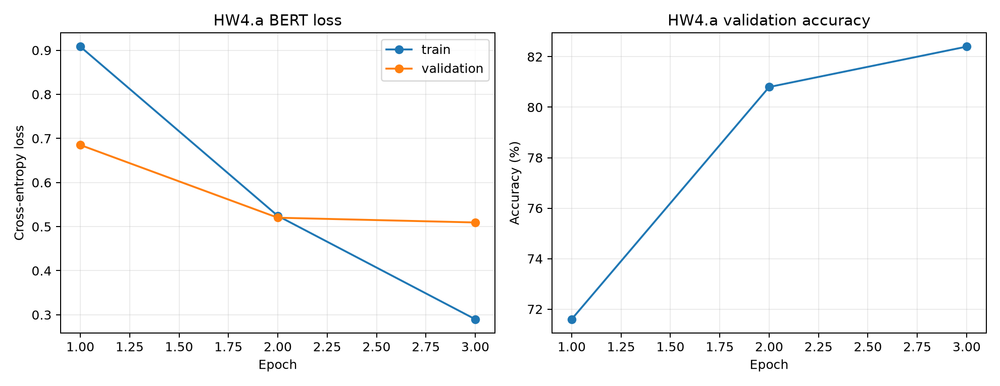
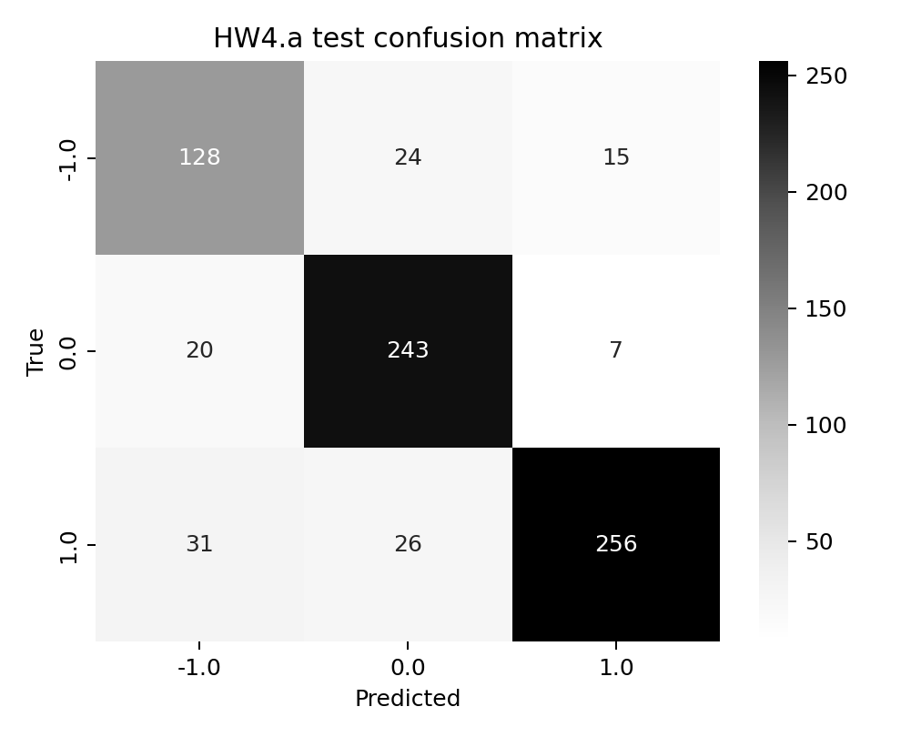

# HW4.a: BERT sentiment and serving

Student: Denisha Ketan Tank

SID4 = 8834, SEED = 8834, SLICE = 834, HP_ID = 2, CLS_A = 4, CLS_B = 6.

Actual GPU: Tesla T4; UUID: `GPU-07e9693f-0780-d80f-57ed-406c0604fd80`; VRAM: 15.00 GiB; driver: 580.82.07; PyTorch CUDA: 12.8.

Dataset: Kaggle saurabhshahane/twitter-sentiment-dataset, Twitter_Data.csv. Zero-based rows 834 through 5833 inclusive, Python slice [834:5834). SHA-256: `5a7af1ec5fc749ec8e5ea13c574aeb5c06254aa1c081e3421868079d5356b3f4`. The fixed SEED 8834 stratified split is 3,500/750/750. Every comparison reuses these exact saved split indices.

I kept the data slice and split fixed so that the later memory experiments would use the same examples as this baseline. The BERT baseline uses FP32 weights. Memory values are in GiB, and the training-memory figure means peak PyTorch allocation, not the entire GPU's memory use. Accuracy values in the tables are fractions. Labels -1, 0 and 1 represent negative, neutral and positive sentiment.

## BERT results

I fine-tuned BERT for three epochs using batch size 16, sequence length 128 and learning rate 0.00002. It reached 83.60% test accuracy. Training and validation together took 255.65 seconds, and peak training allocation was 2.466 GiB.

Validation loss fell in every epoch, while validation accuracy rose from 71.60% to 82.40%. Epoch 3 was the best observed validation point and also the last epoch. I therefore did not observe a later epoch that added training time without improving validation accuracy.

| epoch | training_loss | validation_loss | validation_accuracy | training_seconds |
|---|---|---|---|---|
| 1 | 0.9082 | 0.6851 | 0.7160 | 75.3306 |
| 2 | 0.5244 | 0.5202 | 0.8080 | 79.3926 |
| 3 | 0.2899 | 0.5094 | 0.8240 | 82.4588 |

| class_label | precision | recall | support |
|---|---|---|---|
| -1.0 | 0.7151 | 0.7665 | 167 |
| 0.0 | 0.8294 | 0.9000 | 270 |
| 1.0 | 0.9209 | 0.8179 | 313 |

Negative sentiment had the lowest recall, at 76.65%. Several tweets mix criticism of one person with support for another, which makes a single sentiment label difficult to interpret. These five errors come from the test set. My comments describe possible issues in the wording, not a verified explanation of the model's internal decisions.

| source_row | true_class | predicted_class | text | diagnosis |
|---|---|---|---|---|
| 1667 | -1.0 | 1.0 | ratan naval tata family patriarch the billion tata empire has lavished praise prime minister narendra modi underscoring that his leadership what the country needsat this point time and urging citizens rally round his vision create new india | The tweet openly praises Modi, so the positive prediction fits the visible wording. The negative label may depend on missing context or annotation noise. |
| 3127 | -1.0 | 1.0 | from rahul gandhis fake promise today from where will bring money this much money india than according him modi government failure and chowkidar chor than more than this money was india before five years than why not thought this  | The tweet uses criticism and rhetorical questions about different leaders. The positive output misses that critical tone. |
| 4326 | -1.0 | 0.0 | talk about looting hypocrite modi took white money converted black gave trolls everone knows who else | Words such as looting and hypocrite express criticism. The neutral prediction misses those negative cues in the informal text. |
| 5127 | -1.0 | 0.0 | took you hrs raju finally break silence this did you spend them thinking how you will bring modi into this without appearing monkey balancing that case you wasted that time | The writer mocks the other person through a rhetorical question. Treating it as neutral loses the criticism in the wording. |
| 4162 | -1.0 | 1.0 | bullshit congressmen india controlled remote whose controller italian converted parsi claiming herself citizen the countrywhich only documents not her heart her name sonia ghandyif the hindusmuslimsetcwant goodthen vote only modi | The tweet attacks Congress but ends by supporting Modi. Its mixed targets offer a possible reason for the positive output despite the negative label. |

## Saved model and custom inference

I saved the classifier and tokenizer, loaded them again, and used the restored model for these two examples.

| text | predicted_class | confidence |
|---|---|---|
| The movie was thoughtful, funny, and much better than I expected. | 1.0 | 0.9576 |
| The story dragged for hours and the ending was disappointing. | -1.0 | 0.9301 |

## HF and vLLM serving

For serving, I used Qwen2.5-0.5B-Instruct, a different model from the BERT classifier. Hugging Face latency is the wall time of each batch-1 request. vLLM latency runs from submitting the batch to each request's own finish timestamp, so tokenization and waiting time are included. Total token throughput is calculated separately from the measured batch wall time.

Both systems used FP16, the same prompt family and exactly 64 new tokens per request. I warmed them up before measuring. Each configuration has at least 100 requests, with at least 20 measured vLLM batches at each batch size. The individual timestamps are saved with the results.

| configuration | tokens_per_second | p50_latency_ms | p95_latency_ms | requests_measured | measured_batches |
|---|---|---|---|---|---|
| HF pipeline, batch 1 | 29.9178 | 2132.9225 | 2201.3567 | 100 | 100 |
| vLLM, batch 1 | 66.3984 | 962.0703 | 1006.2642 | 100 | 100 |
| vLLM, batch 8 | 494.9773 | 1029.8672 | 1086.2345 | 160 | 20 |
| vLLM, batch 32 | 1660.8614 | 1228.0576 | 1274.3907 | 640 | 20 |

None of the tested vLLM batch sizes had worse median latency than the Hugging Face baseline. Within vLLM, batch 32 produced more tokens per second than batch 1, but its median request latency was also higher. For an interactive chatbot I would prioritize latency, especially p95, because users notice slow replies. For offline generation I would care more about the total throughput.

### My prompts and actual generated answers

These are the saved model responses, kept as generated. They are not explanations I have verified as correct. In particular, the mixed-precision answer below should not be taken as a conclusion from my experiment: the measured AMP control used less allocated training memory than the FP32 control.

| configuration | prompt | answer |
|---|---|---|
| HF pipeline, batch 1 | Explain why batching can improve GPU throughput in two sentences. |  Batching allows multiple data points to be processed together, reducing the time and energy required for each individual operation, thereby increasing overall processing speed and efficiency. Additionally, it enables parallelization of tasks across multiple GPUs, allowing for faster computation by utilizing the collective computational power of all available GPUs rather than relying on a single core or |
| HF pipeline, batch 1 | Describe one benefit and one cost of mixed precision training. |  One benefit of mixed precision training is that it allows for more accurate predictions, as the model can handle larger numbers of parameters and operations efficiently. This can lead to faster training times and improved performance on certain tasks.  One cost associated with mixed precision training is that it requires additional computational resources and memory to store and manipulate the data |
| vLLM, batch 1 | Explain why batching can improve GPU throughput in two sentences. |  Batching can improve GPU throughput by allowing multiple data sets to be processed simultaneously, reducing the time required to complete a task, and increasing the overall efficiency of the computation. Additionally, batching can help to minimize memory usage and improve the performance of the GPU by reducing the amount of data that needs to be transferred between the CPU |
| vLLM, batch 8 | Explain why batching can improve GPU throughput in two sentences. |  Batching can improve GPU throughput by allowing multiple data sets to be processed simultaneously, reducing the time required to complete a task, and increasing the overall efficiency of the computation. Additionally, batching can help to minimize memory usage and improve the performance of the GPU by reducing the amount of data that needs to be transferred between the CPU |
| vLLM, batch 32 | Explain why batching can improve GPU throughput in two sentences. |  Batching can improve GPU throughput by allowing multiple data sets to be processed simultaneously, reducing the time required to complete a task, and increasing the overall efficiency of the computation. Additionally, batching can help to minimize memory usage and improve the performance of the GPU by reducing the amount of data that needs to be transferred between the CPU |

