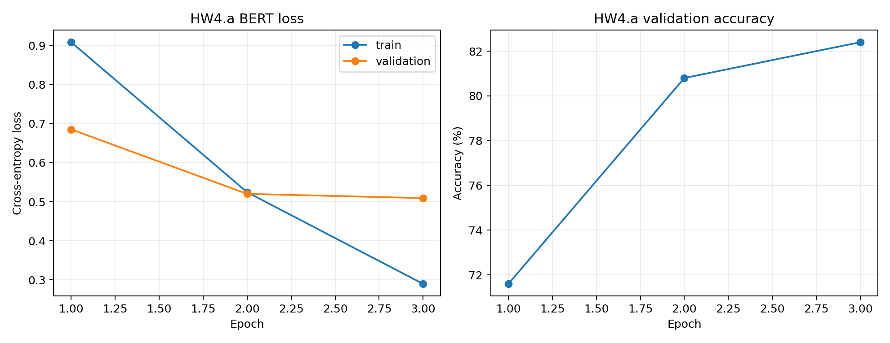
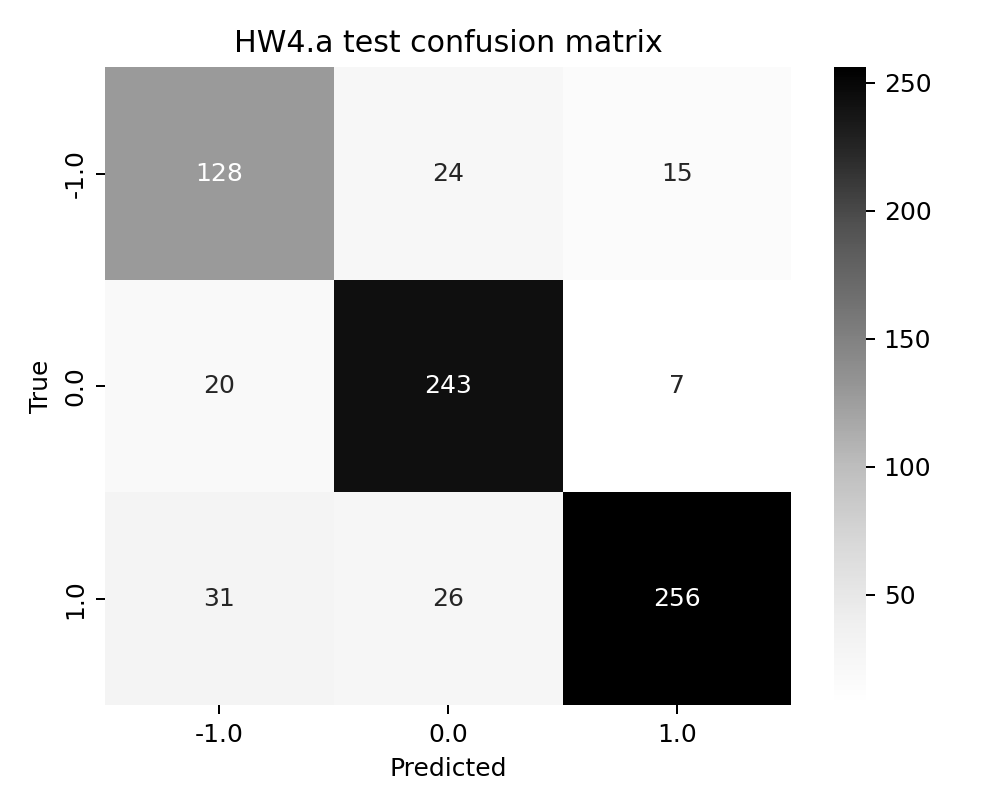

# HW4.a: BERT sentiment and serving

Student: Denisha Ketan Tank

SID4 = 8834, SEED = 8834, SLICE = 834, HP_ID = 2, CLS_A = 4, CLS_B = 6.

Actual GPU: Tesla T4; UUID: `GPU-07e9693f-0780-d80f-57ed-406c0604fd80`; VRAM: 15.00 GiB; driver: 580.82.07; PyTorch CUDA: 12.8.

Dataset: Kaggle saurabhshahane/twitter-sentiment-dataset, Twitter_Data.csv. Zero-based rows 834 through 5833 inclusive, Python slice [834:5834). SHA-256: `5a7af1ec5fc749ec8e5ea13c574aeb5c06254aa1c081e3421868079d5356b3f4`. The fixed SEED 8834 stratified split is 3,500/750/750. Every comparison reuses these exact saved split indices.

Memory is reported in binary GiB. Peak allocated training memory, total GPU-process usage, reserved cache storage, and actively occupied cache blocks are different measurements.

Training parameters remain FP32. AMP uses T4-compatible FP16 with conservative loss scaling; the actual autocast dtype is saved in each result. T4 does not support native BF16 or TF32. A recoverable overflow repeats the same logical update at lower scale, restores dropout RNG, and changes no weights until successful. The repeat cost stays in measured time and memory, and overflow retry counts are saved in the raw results. Persistent numerical failure stops instead of being called a successful update.

Accuracy columns in the tables are fractions from 0 to 1. Dataset labels -1, 0, and 1 mean negative, neutral, and positive sentiment.

## BERT results

The original model used batch 16, sequence length 128, learning rate 0.00002, and three full epochs. Test accuracy was 83.60%. Training plus validation took 255.65 seconds, with 2.466 GiB peak training allocation.

The best validation accuracy occurred at epoch 3. The best point was the final epoch, so no later training cost is claimed.

| epoch | training_loss | validation_loss | validation_accuracy | training_seconds |
|---|---|---|---|---|
| 1 | 0.9082 | 0.6851 | 0.7160 | 75.3306 |
| 2 | 0.5244 | 0.5202 | 0.8080 | 79.3926 |
| 3 | 0.2899 | 0.5094 | 0.8240 | 82.4588 |

| class_label | precision | recall | support |
|---|---|---|---|
| -1.0 | 0.7151 | 0.7665 | 167 |
| 0.0 | 0.8294 | 0.9000 | 270 |
| 1.0 | 0.9209 | 0.8179 | 313 |

The lowest-recall class was -1.0. The following are actual errors from that class. The diagnoses discuss wording, not proven internal model mechanisms.

| source_row | true_class | predicted_class | text | diagnosis |
|---|---|---|---|---|
| 1667 | -1.0 | 1.0 | ratan naval tata family patriarch the billion tata empire has lavished praise prime minister narendra modi underscoring that his leadership what the country needsat this point time and urging citizens rally round his vision create new india | The wording includes leadership, praise; that may explain the prediction 1.0, while the recorded label is -1.0. Missing context or label noise should be considered before assuming the annotation is unambiguous. |
| 3127 | -1.0 | 1.0 | from rahul gandhis fake promise today from where will bring money this much money india than according him modi government failure and chowkidar chor than more than this money was india before five years than why not thought this  | The wording includes chor, failure, fake, but the prediction is 1.0; those critical cues are not reflected in the output. This is a text-based diagnosis, not proof of the model's internal cause. |
| 4326 | -1.0 | 0.0 | talk about looting hypocrite modi took white money converted black gave trolls everone knows who else | The wording includes hypocrite, looting, trolls, but the prediction is 0.0; those critical cues are not reflected in the output. This is a text-based diagnosis, not proof of the model's internal cause. |
| 5127 | -1.0 | 0.0 | took you hrs raju finally break silence this did you spend them thinking how you will bring modi into this without appearing monkey balancing that case you wasted that time | The wording includes wasted, but the prediction is 0.0; those critical cues are not reflected in the output. This is a text-based diagnosis, not proof of the model's internal cause. |
| 4162 | -1.0 | 1.0 | bullshit congressmen india controlled remote whose controller italian converted parsi claiming herself citizen the countrywhich only documents not her heart her name sonia ghandyif the hindusmuslimsetcwant goodthen vote only modi | The wording includes bullshit, but the prediction is 1.0; those critical cues are not reflected in the output. This is a text-based diagnosis, not proof of the model's internal cause. |

## Saved model and custom inference

The classifier and tokenizer were saved and reloaded before these two predictions.

| text | predicted_class | confidence |
|---|---|---|
| The movie was thoughtful, funny, and much better than I expected. | 1.0 | 0.9576 |
| The story dragged for hours and the ending was disappointing. | -1.0 | 0.9301 |

## HF and vLLM serving

HF pipeline wall time for each batch-1 request; vLLM individual finished_time minus client submission time, including tokenization, admission, and queue time. Each request has its own completion timestamp; engine arrival_time is also saved.

Each mode generates exactly 64 new tokens, is warmed up, and uses the same raw prompt family and FP16 model. Each row has at least 100 real requests. vLLM batches have at least 20 measured repetitions. Individual request timestamps and raw observations are saved, so requests are not all assigned the enclosing batch time.

| configuration | tokens_per_second | p50_latency_ms | p95_latency_ms | requests_measured | measured_batches |
|---|---|---|---|---|---|
| HF pipeline, batch 1 | 29.9178 | 2132.9225 | 2201.3567 | 100 | 100 |
| vLLM, batch 1 | 66.3984 | 962.0703 | 1006.2642 | 100 | 100 |
| vLLM, batch 8 | 494.9773 | 1029.8672 | 1086.2345 | 160 | 20 |
| vLLM, batch 32 | 1660.8614 | 1228.0576 | 1274.3907 | 640 | 20 |

No tested batch showed worse median request latency than HF while throughput was still increasing. Batching can finish more tokens per second even when individual requests wait longer. For an interactive chatbot I would prioritize request latency, especially p95. For offline generation, total throughput is usually more important.

### My prompts and actual generated answers

| configuration | prompt | answer |
|---|---|---|
| HF pipeline, batch 1 | Explain why batching can improve GPU throughput in two sentences. |  Batching allows multiple data points to be processed together, reducing the time and energy required for each individual operation, thereby increasing overall processing speed and efficiency. Additionally, it enables parallelization of tasks across multiple GPUs, allowing for faster computation by utilizing the collective computational power of all available GPUs rather than relying on a single core or |
| HF pipeline, batch 1 | Describe one benefit and one cost of mixed precision training. |  One benefit of mixed precision training is that it allows for more accurate predictions, as the model can handle larger numbers of parameters and operations efficiently. This can lead to faster training times and improved performance on certain tasks.  One cost associated with mixed precision training is that it requires additional computational resources and memory to store and manipulate the data |
| vLLM, batch 1 | Explain why batching can improve GPU throughput in two sentences. |  Batching can improve GPU throughput by allowing multiple data sets to be processed simultaneously, reducing the time required to complete a task, and increasing the overall efficiency of the computation. Additionally, batching can help to minimize memory usage and improve the performance of the GPU by reducing the amount of data that needs to be transferred between the CPU |
| vLLM, batch 8 | Explain why batching can improve GPU throughput in two sentences. |  Batching can improve GPU throughput by allowing multiple data sets to be processed simultaneously, reducing the time required to complete a task, and increasing the overall efficiency of the computation. Additionally, batching can help to minimize memory usage and improve the performance of the GPU by reducing the amount of data that needs to be transferred between the CPU |
| vLLM, batch 32 | Explain why batching can improve GPU throughput in two sentences. |  Batching can improve GPU throughput by allowing multiple data sets to be processed simultaneously, reducing the time required to complete a task, and increasing the overall efficiency of the computation. Additionally, batching can help to minimize memory usage and improve the performance of the GPU by reducing the amount of data that needs to be transferred between the CPU |

