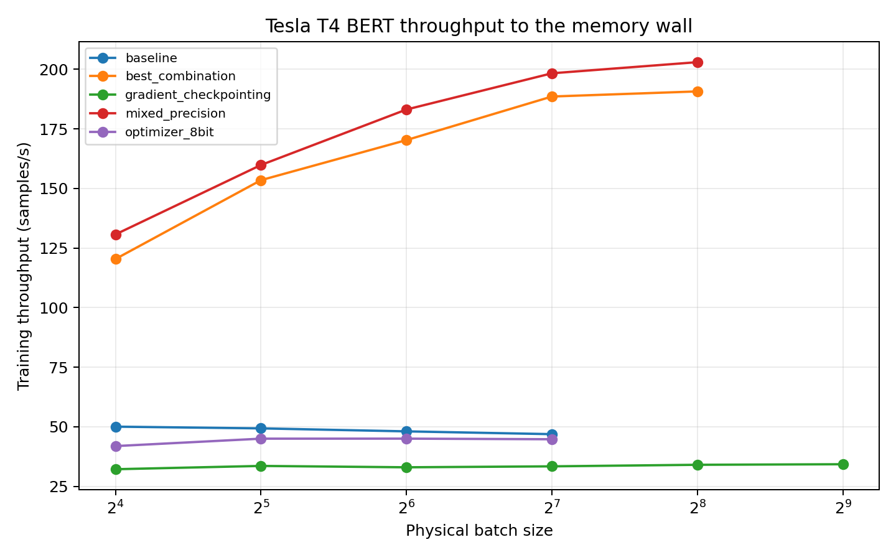
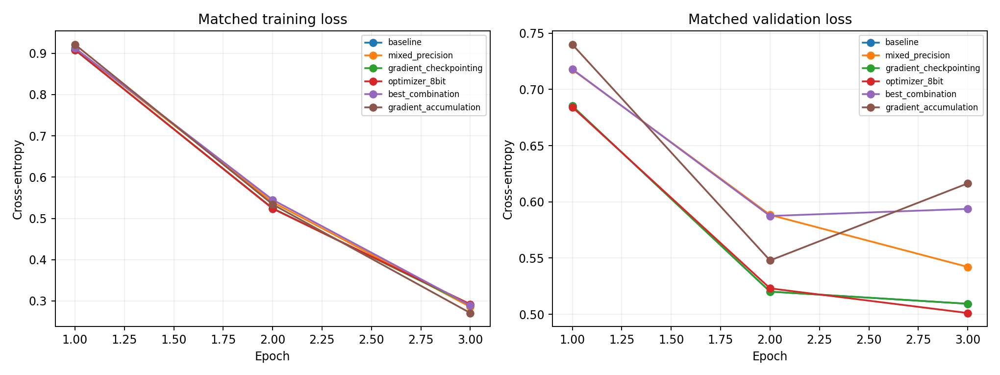

# HW4.5: throughput, memory, and serving

Student: Denisha Ketan Tank

SID4 = 8834, SEED = 8834, SLICE = 834, HP_ID = 2, CLS_A = 4, CLS_B = 6.

Actual GPU: Tesla T4; UUID: `GPU-07e9693f-0780-d80f-57ed-406c0604fd80`; VRAM: 15.00 GiB; driver: 580.82.07; PyTorch CUDA: 12.8.

Dataset: Kaggle saurabhshahane/twitter-sentiment-dataset, Twitter_Data.csv. Zero-based rows 834 through 5833 inclusive, Python slice [834:5834). SHA-256: `5a7af1ec5fc749ec8e5ea13c574aeb5c06254aa1c081e3421868079d5356b3f4`. The fixed SEED 8834 stratified split is 3,500/750/750. Every comparison reuses these exact saved split indices.

I reused the HW4.a data, saved split and BERT settings throughout. Memory is reported in GiB. Peak PyTorch training allocation, the total GPU process footprint and vLLM's cache allocation are different quantities, so I kept them separate in the report.

The baseline uses FP32 weights. For AMP, this T4 run uses FP16 with loss scaling. If an update overflows, the code restores the dropout RNG and retries that same update at a lower scale. The retry time stays in the measurement, and unsuccessful attempts are not counted as completed optimizer updates. The raw results record the actual dtype and retry counts.

Accuracy columns in the tables are fractions from 0 to 1. Dataset labels -1, 0, and 1 mean negative, neutral, and positive sentiment.

## Part A: batch scaling

The course clarification permits one GPU, so this report covers the T4 rather than claiming a two-card comparison. I doubled the batch size until the run produced CUDA OOM. Each successful T4 probe shown below completed a full training epoch, and every attempt used a fresh process. The code also supports separately labelled capacity-only probes above the training-set size, but none of the successful memory limits in this T4 table require repeated rows.

| physical_batch | status | measurement_kind | throughput_samples_per_second | peak_memory_allocated_gb | mean_time_per_epoch_seconds |
|---|---|---|---|---|---|
| 16 | success | full_training_epoch | 50.0468 | 2.4657 | 69.9346 |
| 32 | success | full_training_epoch | 49.3244 | 3.7140 | 70.9588 |
| 64 | success | full_training_epoch | 48.0712 | 6.0640 | 72.8086 |
| 128 | success | full_training_epoch | 46.8989 | 10.8660 | 74.6285 |
| 256 | oom | not measured | not measured | not measured | not measured |

The highest measured FP32 throughput was at batch 16: 50.05 samples/s. It fell slightly at each larger batch, reaching 46.90 samples/s at batch 128. In this sweep, a larger batch used more memory without making the epoch faster. Batch 128 was the largest successful FP32 batch, and batch 256 produced CUDA OOM. The original generated text's reference to batch 32 described its first doubling below a 5% improvement rule, not the measured throughput maximum.

## Part B: maximum-batch experiments

| technique | physical_batch | effective_batch | optimizer_steps | throughput_samples_per_second | peak_memory_allocated_gb | test_accuracy |
|---|---|---|---|---|---|---|
| baseline | 128 | 128 | 84 | 45.2084 | 10.8660 | 0.6800 |
| mixed_precision | 256 | 256 | 42 | 189.8607 | 13.9182 | 0.6067 |
| gradient_checkpointing | 512 | 512 | 21 | 33.9665 | 7.5712 | 0.5627 |
| optimizer_8bit | 128 | 128 | 84 | 45.2866 | 10.2491 | 0.6800 |
| best_combination | 256 | 256 | 42 | 190.5405 | 13.2993 | 0.6053 |
| gradient_accumulation | 16 | 128 | 84 | 44.4754 | 2.8807 | 0.6640 |

I trained each maximum-batch configuration for three full epochs. These rows answer how much data each setup can fit and how it performs at that batch size. They are not a fair test of accuracy alone: larger batches complete fewer optimizer updates in three epochs. For example, the batch-512 checkpointing run has only 21 updates, compared with 657 in the original batch-16 baseline. I therefore used the separate matched-budget comparison below to judge the techniques more fairly.

| technique | memory_capacity_batch | quality_training_batch |
|---|---|---|
| baseline | 128 | 128 |
| mixed_precision | 256 | 256 |
| gradient_checkpointing | 512 | 512 |
| optimizer_8bit | 128 | 128 |
| best_combination | 256 | 256 |

## Part B: matched-budget quality and memory controls

| technique | physical_batch | effective_batch | optimizer_steps | throughput_samples_per_second | peak_memory_allocated_gb | test_accuracy |
|---|---|---|---|---|---|---|
| baseline | 16 | 16 | 657 | 44.2698 | 2.4657 | 0.8360 |
| mixed_precision | 16 | 16 | 657 | 126.7957 | 2.2424 | 0.8307 |
| gradient_checkpointing | 16 | 16 | 657 | 30.7502 | 1.6812 | 0.8360 |
| optimizer_8bit | 16 | 16 | 657 | 41.1716 | 1.8642 | 0.8267 |
| best_combination | 16 | 16 | 657 | 122.4189 | 1.6196 | 0.8267 |
| gradient_accumulation | 4 | 16 | 657 | 38.5309 | 1.9987 | 0.8280 |

For this comparison, all six conditions use effective batch 16, three epochs, 10,500 examples and 657 completed optimizer updates. Only accumulation changes the physical batch to four and combines four microbatches. The data order, initialization seed and learning rate are fixed. Small differences in accuracy remain possible because of dropout and numerical precision, and one run per condition is not enough to establish statistical significance.

### Four independent techniques ranked by memory saved per throughput lost

| rank | technique | memory_saved_GiB | throughput_change | GiB_saved_per_sample_per_second_lost |
|---|---|---|---|---|
| 1 | mixed_precision | 0.2233 | 82.5259 | no throughput loss |
| 2 | optimizer_8bit | 0.6015 | -3.0982 | 0.1942 |
| 3 | gradient_accumulation | 0.4670 | -5.7389 | 0.0814 |
| 4 | gradient_checkpointing | 0.7845 | -13.5196 | 0.0580 |

I ranked the four techniques separately and left the combined candidate out of this table. AMP saved memory while increasing throughput, so it has no throughput-loss denominator. For the other techniques, the final column divides memory saved by the drop in samples per second.

Checkpointing saved the most memory among the independent matched-batch controls, but throughput fell by 30.5%. That is the tradeoff I expected from recomputing activations during the backward pass.

Accumulation used physical batch 4 with four accumulation steps to keep effective batch 16. It took 293.00 seconds to complete the same 657 updates, compared with 255.65 seconds for the direct batch. It helped fit the batch in less memory, but it did not make this run faster.

AMP would be my first technique to try when throughput matters, followed by checking validation accuracy. On a 32 GiB card, I would skip checkpointing if the intended batch already fits, because its recomputation cost would not solve a memory problem in that case. I did not run a separate 32 GiB-card experiment.

## Part C

Part C skipped (optional)

## Part D: serving repeated on the same GPU

I repeated the HW4.a serving benchmark on the same T4. Hugging Face latency is the wall time of each batch-1 request. For vLLM, each request's finish timestamp is compared with client submission time, including tokenization and waiting. Throughput uses total generated tokens divided by measured batch wall time.

| configuration | tokens_per_second | p50_latency_ms | p95_latency_ms | requests_measured | measured_batches |
|---|---|---|---|---|---|
| HF pipeline, batch 1 | 29.8835 | 2119.8545 | 2222.8503 | 100 | 100 |
| vLLM, batch 1 | 67.4744 | 945.5202 | 996.6970 | 100 | 100 |
| vLLM, batch 8 | 501.2639 | 1012.9035 | 1068.5880 | 160 | 20 |
| vLLM, batch 32 | 1690.8808 | 1203.5182 | 1253.8559 | 640 | 20 |

No tested vLLM batch had worse median latency than the Hugging Face baseline. Increasing the vLLM batch from 1 to 32 improved total throughput, but individual requests took longer. For an interactive application I would prioritize request latency, especially p95. For offline work, the higher total throughput would matter more.

Requests in the same batch share some waiting time, so their measurements are not fully independent. These p95 values describe this benchmark, not a guarantee for a live service with changing traffic.

| configuration | HW4a_tokens_s | HW45_tokens_s | HW4a_p50_ms | HW45_p50_ms | HW4a_p95_ms | HW45_p95_ms |
|---|---|---|---|---|---|---|
| HF pipeline, batch 1 | 29.9178 | 29.8835 | 2132.9225 | 2119.8545 | 2201.3567 | 2222.8503 |
| vLLM, batch 1 | 66.3984 | 67.4744 | 962.0703 | 945.5202 | 1006.2642 | 996.6970 |
| vLLM, batch 8 | 494.9773 | 501.2639 | 1029.8672 | 1012.9035 | 1086.2345 | 1068.5880 |
| vLLM, batch 32 | 1660.8614 | 1690.8808 | 1228.0576 | 1203.5182 | 1274.3907 | 1253.8559 |

Both stages used the same GPU, weights, FP16 precision, 64 output tokens and request-timing method. The memory-budget setting stayed at 0.8000 of total VRAM. The tables show small timing changes between stages, but I did not measure a cause for them. GPU clocks, temperature or background activity are possible contributors rather than confirmed explanations. The cache-pool allocation is saved separately for each stage.

### Observed KV-cache usage and simultaneous batch-8 capacity

For the context test, I measured the actual cache tensor storage and watched the scheduler's occupied blocks. Multiplying occupied blocks by bytes per block gives the reserved KV storage in use, including block rounding. Prefix caching and chunked prefill were disabled. I counted a context length as successful only when all eight full prompts were resident together, rather than accepting a run that quietly processed them in smaller groups.

| context_length | status | cache_pool_bytes | peak_used_cache_blocks | measured_active_kv_bytes | peak_running_requests |
|---|---|---|---|---|---|
| 1 | success | 11393433600 | 8 | 1572864 | 8 |
| 128 | success | 11391467520 | 64 | 12582912 | 8 |
| 256 | success | 11378688000 | 128 | 25165824 | 8 |
| 512 | success | 11305549824 | 256 | 50331648 | 8 |
| 1024 | success | 11156520960 | 512 | 100663296 | 8 |
| 2048 | success | 10858659840 | 1024 | 201326592 | 8 |
| 4096 | success | 10262544384 | 2048 | 402653184 | 8 |
| 8192 | success | 9070706688 | 4096 | 805306368 | 8 |
| 16384 | success | 6686638080 | 8192 | 1610612736 | 8 |
| 24560 | success | 4305715200 | 12280 | 2414346240 | 8 |
| 28656 | success | 3114074112 | 14328 | 2816999424 | 8 |
| 29168 | success | 2966028288 | 14584 | 2867331072 | 8 |
| 29296 | success | 2929262592 | 14648 | 2879913984 | 8 |
| 29424 | batch8_admission_limit | 2891317248 | 12873 | 2530934784 | 7 |
| 29680 | batch8_admission_limit | 2816212992 | 12985 | 2552954880 | 7 |
| 30704 | batch8_admission_limit | 2518155264 | 11514 | 2263744512 | 6 |
| 32767 | batch8_admission_limit | 1918894080 | 8192 | 1610612736 | 4 |

All eight requests fit together at 29,296 prompt tokens each. At 29,424 tokens, only seven were resident together, so that point was recorded as batch8_admission_limit. The tested boundary is therefore 128 tokens wide. It is not an exact one-token maximum.

Each probe starts a fresh V0 engine, sets max_model_len to the prompt length plus one output token, and provisions an eight-request prefill. The resulting cache pool is measured each time. The boundary describes this engine configuration, not every possible use of the T4's physical memory.

The logs distinguish CUDA OOM, cache-allocation failure and inability to admit eight full contexts. Other errors stop the test rather than being reported as memory failures.

## Part E: configuration and GPU-hours

For the final fine-tune, I would keep the FP32 baseline at batch 16. My selection rule was to choose the fastest matched control within one percentage point of the baseline's final validation accuracy. The baseline reached 82.40% validation accuracy, while AMP reached 80.40%, so AMP did not meet that rule despite being faster. Accumulation remained within the rule but was slower. The selected baseline used 2.466 GiB peak allocation, processed 44.27 samples/s, took 255.65 seconds including validation and reached 83.60% test accuracy.

The GPU-hour calculation for that full fine-tune is 1 GPU × 255.65 seconds / 3600 = 0.0710 GPU-hours. That is the cost of one three-epoch training-and-validation run, not the cost of setup or all the experiments combined.

### HW4.5 summary

My selected configuration is the batch-16 FP32 baseline: 2.466 GiB peak allocation, 44.27 samples/s and 255.65 seconds. These figures belong to HW4.5 and are not an HW5 baseline.

