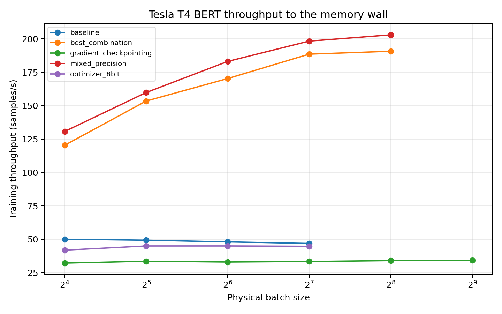
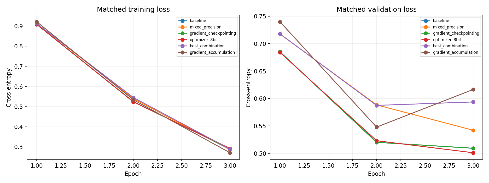

# HW4.5: throughput, memory, and serving

Student: Denisha Ketan Tank

SID4 = 8834, SEED = 8834, SLICE = 834, HP_ID = 2, CLS_A = 4, CLS_B = 6.

Actual GPU: Tesla T4; UUID: `GPU-07e9693f-0780-d80f-57ed-406c0604fd80`; VRAM: 15.00 GiB; driver: 580.82.07; PyTorch CUDA: 12.8.

Dataset: Kaggle saurabhshahane/twitter-sentiment-dataset, Twitter_Data.csv. Zero-based rows 834 through 5833 inclusive, Python slice [834:5834). SHA-256: `5a7af1ec5fc749ec8e5ea13c574aeb5c06254aa1c081e3421868079d5356b3f4`. The fixed SEED 8834 stratified split is 3,500/750/750. Every comparison reuses these exact saved split indices.

Memory is reported in binary GiB. Peak allocated training memory, total GPU-process usage, reserved cache storage, and actively occupied cache blocks are different measurements.

Training parameters remain FP32. AMP uses T4-compatible FP16 with conservative loss scaling; the actual autocast dtype is saved in each result. T4 does not support native BF16 or TF32. A recoverable overflow repeats the same logical update at lower scale, restores dropout RNG, and changes no weights until successful. The repeat cost stays in measured time and memory, and overflow retry counts are saved in the raw results. Persistent numerical failure stops instead of being called a successful update.

Accuracy columns in the tables are fractions from 0 to 1. Dataset labels -1, 0, and 1 mean negative, neutral, and positive sentiment.

## Part A: batch scaling

The clarification permits one GPU, so no second-card result or VRAM ratio is invented. Probes up to the training-set size are complete seeded one-epoch runs. Larger probes repeat training rows for one full physical-batch optimizer update solely to find the memory wall. They are explicitly labelled capacity-only, not used for accuracy or the epoch-throughput plateau. A fresh process is used after every attempt, including the expected OOM.

| physical_batch | status | measurement_kind | throughput_samples_per_second | peak_memory_allocated_gb | mean_time_per_epoch_seconds |
|---|---|---|---|---|---|
| 16 | success | full_training_epoch | 50.0468 | 2.4657 | 69.9346 |
| 32 | success | full_training_epoch | 49.3244 | 3.7140 | 70.9588 |
| 64 | success | full_training_epoch | 48.0712 | 6.0640 | 72.8086 |
| 128 | success | full_training_epoch | 46.8989 | 10.8660 | 74.6285 |
| 256 | oom | not measured | not measured | not measured | not measured |

The highest measured FP32 throughput was at batch 16: 50.05 samples/s. Throughput fell to 49.32, 48.07 and 46.90 samples/s at batches 32, 64 and 128, so increasing the batch beyond 16 did not improve throughput in this sweep. Batch 128 was the largest successful FP32 batch, and batch 256 produced CUDA OOM. The earlier reference to batch 32 meant the first tested doubling below the 5% improvement rule, not the location of the throughput maximum.

## Part B: maximum-batch experiments

| technique | physical_batch | effective_batch | optimizer_steps | throughput_samples_per_second | peak_memory_allocated_gb | test_accuracy |
|---|---|---|---|---|---|---|
| baseline | 128 | 128 | 84 | 45.2084 | 10.8660 | 0.6800 |
| mixed_precision | 256 | 256 | 42 | 189.8607 | 13.9182 | 0.6067 |
| gradient_checkpointing | 512 | 512 | 21 | 33.9665 | 7.5712 | 0.5627 |
| optimizer_8bit | 128 | 128 | 84 | 45.2866 | 10.2491 | 0.6800 |
| best_combination | 256 | 256 | 42 | 190.5405 | 13.2993 | 0.6053 |
| gradient_accumulation | 16 | 128 | 84 | 44.4754 | 2.8807 | 0.6640 |

Each quality configuration was trained for three full epochs at the largest successful power-of-two batch that does not exceed the original training split. Larger capacity-only memory limits are listed below, not claimed as quality-training batch sizes. Changing batch size changes optimizer-update counts, so these accuracy differences cannot be assigned solely to a technique.

| technique | memory_capacity_batch | quality_training_batch |
|---|---|---|
| baseline | 128 | 128 |
| mixed_precision | 256 | 256 |
| gradient_checkpointing | 512 | 512 |
| optimizer_8bit | 128 | 128 |
| best_combination | 256 | 256 |

## Part B: matched-budget quality and memory controls

| technique | physical_batch | effective_batch | optimizer_steps | throughput_samples_per_second | peak_memory_allocated_gb | test_accuracy |
|---|---|---|---|---|---|---|
| baseline | 16 | 16 | 657 | 44.2698 | 2.4657 | 0.8360 |
| mixed_precision | 16 | 16 | 657 | 126.7957 | 2.2424 | 0.8307 |
| gradient_checkpointing | 16 | 16 | 657 | 30.7502 | 1.6812 | 0.8360 |
| optimizer_8bit | 16 | 16 | 657 | 41.1716 | 1.8642 | 0.8267 |
| best_combination | 16 | 16 | 657 | 122.4189 | 1.6196 | 0.8267 |
| gradient_accumulation | 4 | 16 | 657 | 38.5309 | 1.9987 | 0.8280 |

All six controls use effective batch 16, 657 optimizer updates, 10500 examples, and three epochs. Accumulation intentionally uses a smaller physical batch with the same effective batch. Data order, initialization seed, learning rate, and examples are fixed. Dropout and floating-point arithmetic can still produce differences, so a single run does not establish statistical significance.

### Four independent techniques ranked by memory saved per throughput lost

| rank | technique | memory_saved_GiB | throughput_change | GiB_saved_per_sample_per_second_lost |
|---|---|---|---|---|
| 1 | mixed_precision | 0.2233 | 82.5259 | no throughput loss |
| 2 | optimizer_8bit | 0.6015 | -3.0982 | 0.1942 |
| 3 | gradient_accumulation | 0.4670 | -5.7389 | 0.0814 |
| 4 | gradient_checkpointing | 0.7845 | -13.5196 | 0.0580 |

The combined candidate is excluded from the independent ranking. A speedup with a memory saving has no positive throughput-loss denominator; a technique that saves no memory is labelled accordingly.

Checkpointing changed matched-batch throughput by -30.5%. The extra backward recomputation explains why memory savings may have a speed cost; the measured sign is reported even if a short run is noisy.

Matched accumulation used physical batch 4 times 4 accumulation steps. Its time to the same 657 updates was 293.00 seconds, versus 255.65 seconds for the direct batch.

I would first consider mixed_precision from this ranking, while checking its measured validation accuracy. On a 32 GiB card I would not add checkpointing if the required batch already fits and the measured recomputation cost is not worthwhile. That 32 GiB statement is a recommendation, not a second-GPU experiment.

## Part C

Part C skipped (optional)

## Part D: serving repeated on the same GPU

HF pipeline wall time for each batch-1 request; vLLM individual finished_time minus client submission time, including tokenization, admission, and queue time. Each request has its own completion timestamp; engine arrival_time is also saved.

| configuration | tokens_per_second | p50_latency_ms | p95_latency_ms | requests_measured | measured_batches |
|---|---|---|---|---|---|
| HF pipeline, batch 1 | 29.8835 | 2119.8545 | 2222.8503 | 100 | 100 |
| vLLM, batch 1 | 67.4744 | 945.5202 | 996.6970 | 100 | 100 |
| vLLM, batch 8 | 501.2639 | 1012.9035 | 1068.5880 | 160 | 20 |
| vLLM, batch 32 | 1690.8808 | 1203.5182 | 1253.8559 | 640 | 20 |

No tested batch showed worse median request latency than HF while throughput was still increasing. Batching can finish more tokens per second even when individual requests wait longer. For an interactive chatbot I would prioritize request latency, especially p95. For offline generation, total throughput is usually more important.

The request samples within a batch can be correlated. More measured requests improve quantile resolution, but these results are still a benchmark under this workload, not a production p95 guarantee.

| configuration | HW4a_tokens_s | HW45_tokens_s | HW4a_p50_ms | HW45_p50_ms | HW4a_p95_ms | HW45_p95_ms |
|---|---|---|---|---|---|---|
| HF pipeline, batch 1 | 29.9178 | 29.8835 | 2132.9225 | 2119.8545 | 2201.3567 | 2222.8503 |
| vLLM, batch 1 | 66.3984 | 67.4744 | 962.0703 | 945.5202 | 1006.2642 | 996.6970 |
| vLLM, batch 8 | 494.9773 | 501.2639 | 1029.8672 | 1012.9035 | 1086.2345 | 1068.5880 |
| vLLM, batch 32 | 1660.8614 | 1690.8808 | 1228.0576 | 1203.5182 | 1274.3907 | 1253.8559 |

Both stages used the same GPU and weights, FP16, 64 output tokens, individual-request timing, and frozen GPU-memory budget (0.8000 of total VRAM). Background load and GPU clock/temperature may contribute to timing changes; no hardware upgrade is claimed. The actual cache-pool allocation is saved separately in each serving summary.

### Observed KV-cache usage and simultaneous batch-8 capacity

Cache-pool bytes come from the actual GPU tensor storages. Peak occupied blocks are observed after scheduler allocation and before model execution. Multiplying the observed occupied blocks by measured bytes per block gives the active reserved KV storage, including block rounding. This is not an isolated before/after nvidia-smi estimate. Prefix caching and chunked prefill are disabled for the capacity probes, and success requires all eight full prompts to reside together.

| context_length | status | cache_pool_bytes | peak_used_cache_blocks | measured_active_kv_bytes | peak_running_requests |
|---|---|---|---|---|---|
| 1 | success | 11393433600 | 8 | 1572864 | 8 |
| 128 | success | 11391467520 | 64 | 12582912 | 8 |
| 256 | success | 11378688000 | 128 | 25165824 | 8 |
| 512 | success | 11305549824 | 256 | 50331648 | 8 |
| 1024 | success | 11156520960 | 512 | 100663296 | 8 |
| 2048 | success | 10858659840 | 1024 | 201326592 | 8 |
| 4096 | success | 10262544384 | 2048 | 402653184 | 8 |
| 8192 | success | 9070706688 | 4096 | 805306368 | 8 |
| 16384 | success | 6686638080 | 8192 | 1610612736 | 8 |
| 24560 | success | 4305715200 | 12280 | 2414346240 | 8 |
| 28656 | success | 3114074112 | 14328 | 2816999424 | 8 |
| 29168 | success | 2966028288 | 14584 | 2867331072 | 8 |
| 29296 | success | 2929262592 | 14648 | 2879913984 | 8 |
| 29424 | batch8_admission_limit | 2891317248 | 12873 | 2530934784 | 7 |
| 29680 | batch8_admission_limit | 2816212992 | 12985 | 2552954880 | 7 |
| 30704 | batch8_admission_limit | 2518155264 | 11514 | 2263744512 | 6 |
| 32767 | batch8_admission_limit | 1918894080 | 8192 | 1610612736 | 4 |

The longest verified simultaneous batch-8 prompt was 29296 tokens per request. The limiting category was batch8_admission_limit. The successful/failing bracket ends at 29424 and is at most 128 tokens wide; an exact one-token boundary is not claimed.

Each probe provisions a simultaneous eight-request prefill and max_model_len=prompt_length+1, in a fresh V0 engine. The resulting reserved cache pool is measured separately for each configuration. This is an engine-configuration capacity bracket, not a universal hardware-only OOM boundary.

CUDA OOM, an engine cache-allocation limit, and inability to admit eight full contexts are recorded separately. A non-memory exception stops the run rather than being relabelled as an OOM.

## Part E: configuration and GPU-hours

My validation-based choice among the matched controls is baseline. I selected the highest-throughput option whose final validation accuracy was within one percentage point of the matched FP32 baseline, rather than tuning on test accuracy. Its measured training allocation was 2.466 GiB, throughput 44.27 samples/s, wall time 255.65 seconds, and test accuracy 83.60%.

One full fine-tune under that measured configuration used 1 GPU × 255.65 seconds / 3600 = 0.0710 GPU-hours. This excludes setup and the other experimental conditions.

### HW4.5 summary

Selected matched-budget configuration: baseline; 2.466 GiB peak, 44.27 samples/s, 255.65 seconds. It is an HW4.5 result, not an HW5 baseline.

